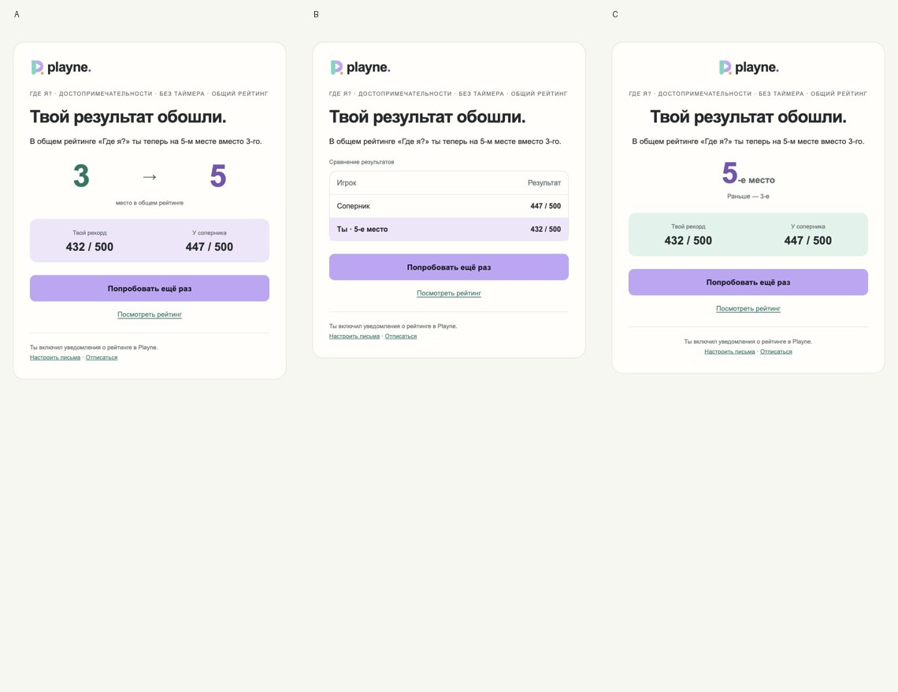

# Проверка уведомлений Playne

28 октября 2026. Реализация и эксплуатация: [план](../EMAIL_NOTIFICATIONS_PLAN.md).

## Автоматические проверки

- Полный набор тестов включает настоящий PostgreSQL 16; тесты рассылок используют отдельную схему и не касаются пользователей сайта.
- Миграция запускается повторно, не теряя данные.
- Покрыты подпись/сроки ссылок, CSRF, отдельное согласие, необязательный email OAuth, отсутствие подписки при обычном входе, подтверждение без сессии, идемпотентность.
- Проверены все игры и отдельные режимы, ничьи и собственные улучшения, дедупликация, возврат места перед отправкой, конкурирующие воркеры, суточный/недельный лимиты, ночь, неизвестный ответ провайдера без повторной отправки.
- Проверены one-click отписка, повторная подписка после отписки провайдера, подпись и повтор callback, закрытый отчёт владельца, уникальные люди вместо повторных писем, исключение сырых GET и незрелых/старых когорт.
- Production-сборки клиента и API, SEO и дизайн-система проходят проверки. Отдельно запускается собранный API и проверяется `/api/health` (одних инъекционных тестов Fastify для проверки запуска воркера недостаточно).

## Визуальная проверка

Исходные три макета и скриншоты отрендеренного HTML сравнены рядом. Сохранены общая палитра, типографическая иерархия, один основной CTA и различия композиции. Контент унифицирован для чистого сравнения оформления, примеры из конкретных игр адаптированы для всех рейтингов.

A — смена места и сравнение, B — таблица с выделением игрока, C — центрированное оформление и мятный блок. Декоративный круг из первоначального примера C не используется для чужих игр. Шаблон обходится без новых тяжёлых иллюстраций.

Формы входа, добровольные галочки, кабинет и подтверждение просмотрены в браузере на ширине 390 px и на десктопе. На узком экране нет горизонтального переполнения формы; таблица закрытого отчёта прокручивается отдельно и доступна с клавиатуры. Нативные поля/checkbox, подписи, фокус, статусы и ошибки сохранены. У согласий нет заранее выбранных галочек. При подтверждении подписки страница не показывает лишнюю форму входа.

Письма — HTML-таблицы с встроенными стилями и текстовой версией. Браузерная проверка не подменяет проверку всех почтовых клиентов: Outlook/Gmail и принудительная перекраска тёмного режима могут отображать детали иначе.

## Реальная контрольная доставка

С согласия владельца три письма `[Тест A/B/C]` отправлены на согласованный адрес. Во всех явно указано, что места и очки вымышлены. Получены три разных job_id; выгрузка событий отдельного проекта подтверждает **delivered / ok_delivered** для каждого — принимающий сервер Яндекса вернул SMTP 250. Эти отправки не создают игровые результаты и не включаются в эксперимент.

Это подтверждает приём почтовым сервером, а не расположение во «Входящих» и не визуальное отображение внутри всех почтовиков.

## Проверки релиза

После выкладки: точный SHA в `/api/health`, изоляция ключа/проекта, настройки только своего пользователя, запрет отчёта гостю, реальный подписанный webhook провайдера, отключённое логирование токенов, основной сайт и рейтинги. Массовых писем и подписки существующих игроков без согласия не запускаем.
